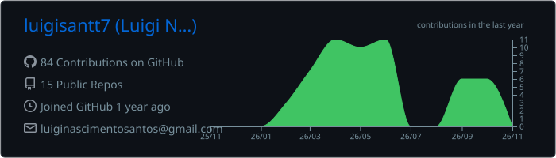
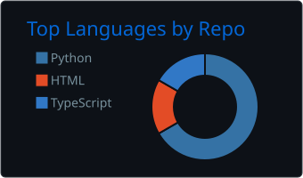
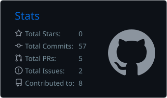

<div align="center">


<a href="https://git.io/typing-svg">
  
</a>

**Dados · IA · Automação** — estudante de Sistemas de Informação construindo soluções orientadas a dados.
<br/>
<sub><i>Data & AI enthusiast turning raw data into decisions and repetitive work into automated workflows.</i></sub>

</div>

---

### 🧠 Sobre mim · About me

```python
luigi = {
    "role":      "Data & AI Intern @ Bradesco — Inteligência em Compras",
    "location":  "São Paulo, Brasil",
    "education": "Sistemas de Informação @ Faculdade Impacta (2025 – 2028)",
    "previous":  "Tax Transformation @ Mercado Livre",

    "working_on": [
        "Dashboards executivos e KPIs para decisões em Procurement",
        "ETL e análise de dados para a alta liderança",
        "Projetos de transformação digital e IA",
    ],
    "learning": ["Machine Learning", "Cloud (AWS / GCP)", "AI Agents & RAG"],
    "languages": {"pt": "native", "en": "B2 / full professional", "es": "basic"},
    "fun_fact":  "Também sou fotógrafo e videomaker",
}
```

- 📊 Transformo dados brutos em **indicadores, dashboards e insights** para tomada de decisão.
- 🤖 Construo **agentes de IA e automações** com n8n, Python e LLMs para eliminar trabalho manual.
- 🧪 Participei do desenvolvimento do **Tax Bot** no Mercado Livre — testes, validação e documentação em bases **RAG**.
- 🌱 Embaixador Google e participante dos bootcamps de **GenAI & Dados** e **Agentes de IA** do Bradesco.

---

### 🛠️ Tech Stack

<div align="center">


</div>

**Linguagens · Languages**


**Dados & Machine Learning · Data & ML**


**BI & Visualização · BI & Analytics**


**IA & Automação · AI & Automation**


**Cloud & Ferramentas · Cloud & Tools**


---

### 💼 Experiência · Experience

| | Onde | O que faço / fiz |
|---|---|---|
| 🏦 | **Bradesco** · Estagiário, Inteligência em Compras <br/><sub>jun/2026 – atual</sub> | Extração e tratamento de dados, dashboards executivos, KPIs de eficiência operacional, PMO de transformação digital e IA |
| 🛒 | **Mercado Livre** · Aprendiz, Tax Transformation <br/><sub>set/2025 – jun/2026</sub> | Automações com Python, agentes de IA com n8n, Tax Bot (RAG), dashboards financeiros (Looker / SAP Ariba), interface com times de tecnologia LATAM |

---

### 🚀 Projetos · Projects

| Projeto | Descrição | Stack |
|---|---|---|
| 🤖 **Tax Bot** | Chatbot fiscal com IA — testes, validação de respostas e documentação em base RAG | `LLMs` `RAG` |
| ⚙️ **Automações & Agentes** | Workflows e agentes de IA que reduziram horas de trabalho manual | `n8n` `Python` `LLMs` |
| 📊 **Dashboards Executivos** | Painéis de indicadores para decisões estratégicas em Procurement | `Power BI` `SQL` `ETL` |
| 🍔 **App de Delivery + Chatbot** | Produto digital com banco de dados, chatbot e UX/UI | `SQL` `Chatbot` `UX/UI` |

---

### 📜 Certificações · Certifications


---

### 📈 GitHub Stats

<div align="center">








</div>

---

### 🤝 Conecte-se · Connect

<div align="center">

[](https://www.linkedin.com/in/luiginsantos/)
[](mailto:luiginascimentosantos@gmail.com)
[](https://github.com/luigisantt7)

<sub><i>"In God we trust. All others must bring data." — W. Edwards Deming</i></sub>

</div>
